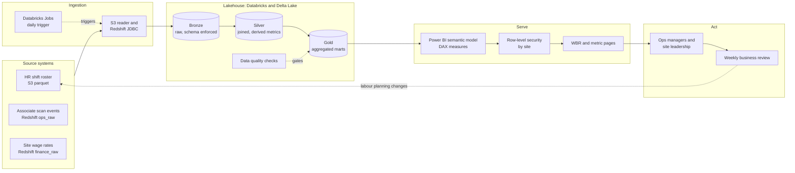
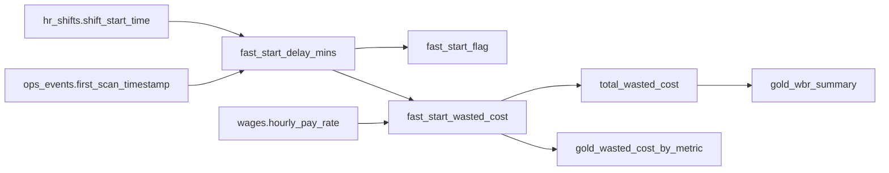

## Tech stack

**Sources:** AWS S3, Amazon Redshift, CSV 

**Data platform:** Databricks (PySpark, Spark SQL), Delta Lake, Medallion architecture (Bronze, Silver, Gold layer)

**Data quality:** layer reconciliation, null, duplicate and range checks

**BI and semantic layer:** Power BI, DAX, Power Query, Row-level security (PII Data Privacy - Limiting access to only approved stakeholders)

# EU Logistics Intelligence Dashboard

An end-to-end analytics product that measured how productively associates start their shift, return from breaks and finish their shift across Amazon EU Logistics, and turned every lost minute into a labour cost that operations managers could act on.

| 1,500+ | £22M | 10–20 pts | 3 |
|:---:|:---:|:---:|:---:|
| monthly active users across EU operations | labour cost saving opportunity identified | compliance improvement at site and country level | shift productivity KPIs tracked daily |

---

## Executive summary

| | |
|---|---|
| **Context** | Associates are paid for every minute they are on site. Time lost at the start of a shift, after a break or before shift end is paid but unproductive, and across thousands of associates a few minutes per shift adds up to a large labour cost. |
| **Problem** | There was no data-driven way to see where productive time was being lost or what it cost. Compliance sat between 50% and 70%, and operations managers had no site, shift or process view to plan against. |
| **Solution** | Every day, the product joins shift schedules, scan events and wage rates, measures each associate's delay against a 15-minute threshold at three points in the shift, and converts the excess minutes into wasted labour cost. Results are ranked by site, country and labour process. |
| **Outcome** | Identified a £22M labour cost saving opportunity and scaled to 1,500+ monthly active users. Over the following quarters, sites and countries improved compliance by 10 to 20 points. |

### The three moments it measures

| Fast Start | Post Break Ramp Up | Strong Finish |
|---|---|---|
| First scan within 15 minutes of shift start | First scan within 15 minutes of break end | Last scan within 15 minutes of shift end |
| Shows slow starts and late process assignment | Shows slow returns to productive work | Shows associates idle before the shift ends |

---

## My role

**Define**
- Gathered requirements with operations managers and site leadership, and agreed the three metrics and the 15-minute threshold
- Designed the data model, the dataset metadata and the wasted cost logic
- Ensured associate-level data was handled within privacy standards, with access restricted by site

**Build**
- Built the medallion pipeline in Databricks (PySpark and Spark SQL) from HR, operations and finance sources
- Built the Power BI semantic model, DAX measures and the WBR and metric pages
- Designed row-level security so each manager sees only their own sites

**Launch**
- Led the launch and drove adoption to 1,500+ monthly active users
- Embedded the dashboard in weekly business reviews so sites tracked compliance week on week
- Owned the roadmap of improvements after launch

---

## Architecture

A daily batch pipeline: ingest from three source systems, clean and join, aggregate, serve, then act on the results in weekly reviews.



**Security and governance:** associate IDs pseudonymised, row-level security by site, access for authorised operations managers only.
**Monitoring:** row-count reconciliation across layers, null and duplicate checks, and a compliance sanity range before gold tables publish.

### Medallion layers

| Layer | Tables | What happens |
|---|---|---|
| Bronze | `bronze_hr_shifts`, `bronze_ops_events`, `bronze_wages` | Raw ingestion from each source, schema enforced, ingestion timestamp and source system added |
| Silver | `silver_shift_compliance` | Sources joined on associate, site and shift date; delays, compliance flags, week label and wasted cost derived |
| Gold | `gold_compliance_by_country_week`, `gold_compliance_by_process`, `gold_wasted_cost_by_metric`, `gold_wbr_summary` | Aggregated marts that Power BI reads directly |

---

## Output dataset

`silver_shift_compliance`, the governed table every gold mart and dashboard page is built from.

| Property | Value |
|---|---|
| Owner | EU Data & Analytics (technical owner: Hrishikesh Choudhari) |
| Consumers | Operations managers, site leadership, EU operations WBR |
| Grain | Associate × site × shift date |
| Refresh and SLA | Daily batch, D-1 data available by 09:00 UK time |
| Classification | Confidential. Associate-level; IDs pseudonymised |
| Access | Row-level: each manager sees only their own sites |
| Quality checks | Null keys, duplicate associate-shift rows, layer row-count reconciliation, compliance range check |

<details>
<summary><b>Schema</b></summary>

| Column | Type | Description |
|---|---|---|
| `associate_id` | STRING | Pseudonymised associate identifier |
| `site_id` | STRING | Logistics site |
| `site_country` | STRING | Country of the site |
| `shift_date` | DATE | Date of the shift |
| `week_label` | STRING | ISO week, YYYY-WW |
| `labor_process` | STRING | Container building, container staging, sortation, truck loading, truck unloading, problem solve, customer returns |
| `shift_start_time` | TIMESTAMP | Scheduled shift start |
| `break_end_time` | TIMESTAMP | Scheduled break end |
| `shift_end_time` | TIMESTAMP | Scheduled shift end |
| `first_scan_timestamp` | TIMESTAMP | First scan of the shift |
| `first_scan_post_break_timestamp` | TIMESTAMP | First scan after the break |
| `last_scan_timestamp` | TIMESTAMP | Last scan of the shift |
| `hourly_pay_rate` | DECIMAL | Site hourly rate |
| `fast_start_delay_mins` | DECIMAL | Minutes from shift start to first scan |
| `post_break_rampup_delay_mins` | DECIMAL | Minutes from break end to first post-break scan |
| `strong_finish_gap_mins` | DECIMAL | Minutes from last scan to shift end |
| `fast_start_flag`, `post_break_flag`, `strong_finish_flag` | INT | 1 when within the 15-minute threshold, else 0 |
| `fast_start_wasted_cost`, `post_break_wasted_cost`, `strong_finish_wasted_cost` | DECIMAL | Cost of minutes beyond the threshold |
| `total_wasted_cost` | DECIMAL | Sum of the three |

</details>

### Column-level lineage (example: `fast_start_wasted_cost`)



---

## Metric catalogue

One definition per metric, held in the silver layer so every page agrees.

| Metric | Definition | Why it matters |
|---|---|---|
| Fast Start compliance | % of shifts with first scan ≤ 15 min after shift start | Shows how quickly sites get associates productive |
| Post Break compliance | % of shifts with first post-break scan ≤ 15 min after break end | Shows time lost returning from breaks |
| Strong Finish compliance | % of shifts with last scan ≤ 15 min before shift end | Shows paid time with no work planned |
| Wasted cost (per metric) | max(delay − 15, 0) ÷ 60 × hourly rate, for non-compliant shifts | Puts a money value on each lost minute |
| Total wasted cost | Sum of the three wasted costs | Size of the saving opportunity |
| Compliance by process | Each compliance rate by labour process | Shows which processes need better planning |
| Avg delay | Average minutes of delay per metric | Shows how far sites are from the threshold |

Only minutes beyond the 15-minute threshold are costed, so a shift that starts 30 minutes late counts 15 wasted minutes, not 30.

---

## Dashboard pages

1. **Read me:** product summary, owners, refresh schedule, metric definitions, support links
2. **WBR:** all three compliance rates, week-on-week trend, wasted cost by metric and a country summary with status
3. **Fast Start:** KPI cards, site and week matrix, compliance vs wasted cost scatter
4. **Post Break Ramp Up:** same layout for the post-break metric
5. **Strong Finish:** same layout for the end-of-shift metric

---

## Business impact

- **Cost:** identified a £22M labour cost saving opportunity across EU operations
- **Adoption:** scaled to 1,500+ monthly active users across operations teams
- **Behaviour:** compliance moved from a 50–70% baseline, with 10 to 20 point improvements at site and country level over the following quarters
- **Visibility:** gave operations their first data-driven view of where and when productive time was lost

---

## Production design vs this rebuild

| In production | In this repository |
|---|---|
| HR shifts read from S3 | Same notebook, reading a sample file uploaded to Databricks; the S3 code is shown commented out |
| Scan events and wages read from Redshift over JDBC | Same, with the Redshift connection code shown commented out |
| Scheduled Databricks job | Notebooks run in order by hand |
| Real associate and site data | Synthetic data: 426K shifts, 25 sites, 15 countries, January to August 2025 |

---

---

## Repository contents

```
├── README.md                          this file
├── notebooks/
│   └── Flow_KPI_Pipeline.dbc          Databricks archive: bronze, silver, gold and data quality notebooks
├── data/
│   └── Flow_KPI_Dashboard.xlsx        synthetic source data
├── powerbi/
│   └── Flow_KPI_Dashboard.pbix        Power BI report
└── images/
    ├── architecture.png
    └── dashboard_wbr.png
```

### How to run

1. In Databricks, go to Workspace, then Import, and upload `notebooks/Flow_KPI_Pipeline.dbc`.
2. Upload `data/Flow_KPI_Dashboard.xlsx` to `/FileStore/Flow_KPI_Dashboard.xlsx`.
3. Run the notebooks in order: bronze ingestion, silver transformation, gold aggregation, data quality checks.
4. Open `powerbi/Flow_KPI_Dashboard.pbix` in Power BI Desktop to explore the dashboard.

---
### Databricks View:
1) Bronze Layer - Loading Raw Data


2) Silver Layer - Performing data cleaning and adding extra fields for business layer


3) Gold Layer - Business Layer


### Dashboard View (Power BI):


## About this repository

This is a case study of a data product I delivered at Amazon, rebuilt for my portfolio. It contains no Amazon code, data or internal documents. Table names, schemas and architecture are representative, and dashboard figures are illustrative. Impact figures reflect results I reported in my role.

